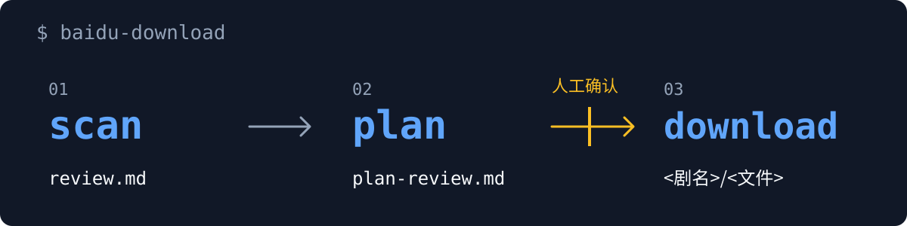

# Baidu Download

**See what is shared. Choose what to keep. Download only that plan.**

A Python CLI for downloading selected videos and covers from Baidu Netdisk shares. Inspect one link or a named batch, approve exact files, then resume interrupted downloads with progress and media checks.

<p>
  
</p>

**Verified locally:** 16 offline behavior tests, including the full CLI workflow and a real local MP4 probe. Tested on Python 3.12 and 3.14, including an isolated wheel installation. These checks are separate from live provider availability; they do not promise a download speed.

## Start here

Requires **Python 3.11+**, **macOS or Linux**, and a destination with **hard-link support**, such as APFS or ext4. ExFAT/FAT destinations are unsupported. Video checks require **ffprobe**; fetching the pinned public protocol reference uses **GitHub CLI** or supplied stdin data.

```sh
git clone https://github.com/sys98/baidu-download.git
cd baidu-download
uv tool install .
baidu-download doctor
```

`doctor` checks local prerequisites without signing in or making network requests. Install [uv](https://docs.astral.sh/uv/getting-started/installation/), [ffmpeg/ffprobe](https://ffmpeg.org/download.html), and [GitHub CLI](https://cli.github.com/) as needed. Cover-only downloads do not require ffprobe, although `doctor` reports it as missing.

## One link, one reviewed plan

### 1. Inspect the share

Run the first two lines and enter your share URL and preferred drama title at the prompts, then scan:

```sh
read -r SHARE_URL
read -r TITLE
baidu-download scan --url "$SHARE_URL" --title "$TITLE" --job ./job
```

Open `job/review.md`. Scanning enumerates nested directories and all pages; it downloads no media and makes no account-side copies. Account credentials and extraction codes use hidden prompts when not supplied through the process environment.

### 2. Choose the videos and covers

Edit the generated `job/selection.json`, which starts empty. After verifying that group 1 is the intended video directory, a selection can look like this:

```json
[
  {"source_id": "1", "groups": [1], "file_ids": [], "cover_ids": []}
]
```

Use `file_ids` instead of a whole group to select specific videos. Add image IDs from the review to `cover_ids` for one or more cover variants.

**Co-location is a candidate signal, not proof of relevance.** Names and episode numbers do not select your files. Unrelated videos in the same directory remain visible for human review.

### 3. Confirm and download

```sh
baidu-download plan --job ./job --destination ./media
# Read job/plan-review.md before the next command.
baidu-download download --job ./job --workers 4
```

Type the displayed `DOWNLOAD <plan_id>` phrase to approve the exact scope. The tool checks live file identities, sizes and types before transferring media. Files keep their original names under `media/<title>/`.

An unchanged approved plan can resume with the same download command. A changed selection, destination or source file requires renewed review. Only verified files are reused; unrelated files and partials are never overwritten.

## Keep track of the run

```sh
baidu-download status --job ./job
baidu-download verify --job ./job --deep
```

- Download progress reports current-run transferred bytes and interval MB/s.
- `speed.csv` keeps timing samples; reused files and pre-existing partial bytes do not inflate transfer speed.
- `verify --deep` probes video streams and fully decodes/checksums images. It is not a frame-by-frame video decode.
- Up to four isolated sessions download concurrently; provider failures stop new work, while owned partial files remain resumable.

## Use a batch or another script

A batch is a JSON list of named shares with `title`, `share_url`, and optional `id`, `expected_episodes`, and `extraction_code`. Declared episode-count mismatches stay visible before approval.

```sh
baidu-download scan --sources ./sources.json --job ./batch-job
```

Then review and select files just as for a single link. See the [full usage guide](./docs/usage.md) for batch input, authentication, stdin protocol loading, Python functions, and recovery. No fundrive-baidu SDK installation or local SDK patch is required.

## Authentication and limits

Account credentials come from hidden prompts or existing `BAIDU_BDUSS` and `BAIDU_STOKEN` process variables. Optional `BAIDU_SHARE_CODE` supplies an extraction code. The tool does not load `.env` files or browser credentials, and generated reports contain no account credentials or signed download URLs.

The provider's client APIs can change or require account verification. The tool reports these failures instead of bypassing them, and does not automatically solve CAPTCHAs. Use it only for files you are authorized to access and download.

## Development and attribution

```sh
uv run python -m unittest discover -s tests -v
uv build
```

Tests use temporary directories and mocked provider responses. The optional real-MP4 test also requires ffmpeg/ffprobe and is explicitly skipped when they are unavailable.

The public protocol reference is the [OpenList Baidu share plugin at a pinned commit](https://github.com/OpenListTeam/openlist-baidushare-plugin/tree/8515b0f7bfa715007c833d1374fdb10b65fcc217). Its MIT notice is retained in [THIRD-PARTY-LICENSE.txt](./THIRD-PARTY-LICENSE.txt). Remote source is parsed as data in memory, never executed or saved.
